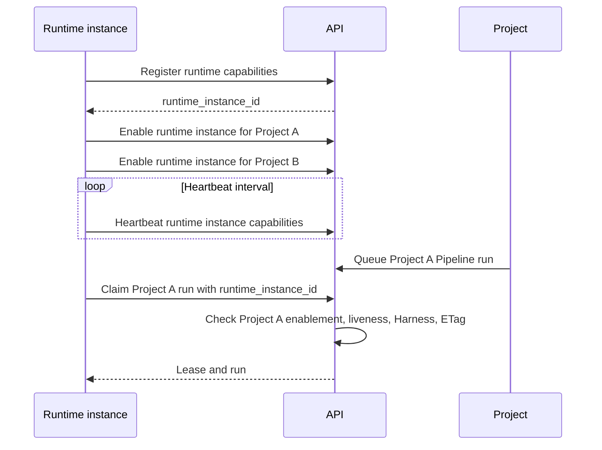

# Runtime Worker and Project Identity Model

6 October 2026

## Context

The runtime configuration maps each configured Project to a local Git checkout.
Each Project mapping currently persists its own API-generated `worker_id`:

```json
{
  "projects": [
    {
      "project_id": "project-a",
      "repository_path": "/app/data/projects/project-a",
      "worker_id": "worker-a"
    },
    {
      "project_id": "project-b",
      "repository_path": "/app/data/projects/project-b",
      "worker_id": "worker-b"
    }
  ]
}
```

The runtime provisions a Worker through the selected Project context, then uses
that ID with the same Project context for heartbeats and Pipeline claims. The
API persists workers with `project_id`, and worker lookups, readiness, and
capability checks are Project-scoped.

This means one operating runtime process has multiple Worker registrations when
it manages multiple Projects. The current `worker_id` identifies a Project
registration rather than the runtime instance itself.

## Why This Matters

The present model is operationally valid, but it conflates two concepts:

* A runtime instance: one long-lived process or container with a configuration,
  local Harness capabilities, and one or more mounted checkouts.
* A Project enablement: permission for that runtime instance to claim and
  execute work for one Project in one checkout.

Treating each `(project_id, worker_id)` pair as an independent Worker makes the
runtime configuration harder to explain, duplicates liveness and capability
reports, and obscures which runtime process is available across Projects.

A runtime-instance identity could make the control plane answer clearer
questions: which runtime instances are connected, which Harnesses each instance
can execute, and which Projects each instance is enabled to serve.

## Investigation

Perform a cross-repository analysis of `looping-louie-api`,
`looping-louie-runtime`, `looping-louie-cli`, and `looping-louie-app`.

Document the current contract end to end:

* Runtime configuration, first-start provisioning, persisted worker IDs,
  heartbeats, readiness, Pipeline claims, leases, and checkpoint reporting.
* API worker schema, persistence constraints, Project request context, worker
  capability admission, and Pipeline-run ownership/audit fields.
* CLI and application assumptions about Worker IDs, worker readiness, and
  Project scoping.
* Existing migration and backward-compatibility constraints.

Compare at least these models:

1. Preserve Project-scoped Worker registrations, while documenting that a
   runtime process has one registration per enabled Project.
2. Introduce one API-owned runtime-instance Worker identity with explicit
   Project enablements and checkout mappings.
3. Separate runtime-instance liveness/capabilities from a Project-scoped
   execution-agent or authorization record.

For each model, evaluate identity uniqueness, authorization boundaries,
capability reporting, liveness, scheduling and claim validation, failure
isolation, auditability, multi-Project Docker deployment, database migration,
and compatibility with deployed runtimes.

## Findings

The current API `workers` resource is a Project-scoped execution registration:

* SQLite persists workers with a composite `(project_id, id)` identity.
* Provisioning, heartbeat, readiness, and claim admission all receive a Project
  context and look up that composite identity.
* A worker's liveness and Harness capabilities are duplicated for every Project
  served by one runtime process.
* Possession of a worker ID is not an independent runtime credential. Requests
  are authorized through the requesting User's Project membership, then scoped
  to the selected Project.
* Pipeline claims persist a plain `worker_id`; existing run records have no
  foreign key to a worker registration.

The runtime's local checkout mapping is intentionally more specific than the
API's scheduling model. A checkout path selects where one runtime executes a
Project's claimed work. The API must not receive or persist a host or container
checkout path.

The CLI and application select a Project through `X-Project-ID`; neither
provisions workers directly. They consume aggregate per-Project readiness and
claim events containing `worker_id`. This keeps the existing Project-selection
workflow viable, but readiness and event contracts need a compatibility plan.

## Architecture Decision

Adopt model 2: a globally identified runtime instance with explicit Project
enablements.

Define the resources as follows:

* **Runtime instance:** one API-owned identity for one configured runtime
  process or container. It owns current liveness and advertised Harness
  capabilities.
* **Runtime Project enablement:** an API-owned association allowing one runtime
  instance to claim work for one Project. It has no checkout path.
* **Runtime checkout mapping:** a runtime-local `runtime.json` association
  between one enabled Project and its local checkout path. It is never sent to
  the API.

The API continues to scope Pipeline runs, authorization, and scheduling by
Project. A claim supplies the runtime-instance ID; the API admits it only when
the instance is active, advertises the frozen Harness exactly, and has an
enabled association with that Project.

This separates process identity from authorization without allowing a runtime
to select an arbitrary checkout or claim work in an unenabled Project.

## Target Lifecycle



A failed or disabled Project enablement blocks claims only for that Project.
A stale runtime heartbeat blocks all new claims for the runtime instance. An
existing Pipeline lease remains governed by its lease token and expiry policy.

## Migration and Compatibility Strategy

This is a structural migration. Existing rows cannot be safely grouped into a
single runtime instance because no current stable process identity links rows
from different Projects. Backfill each existing `(project_id, worker_id)` row
as one runtime instance with one enablement; operators may consolidate those
instances only by re-registering a multi-Project runtime.

Use a compatibility period:

1. Add runtime-instance and enablement tables, endpoints, schemas, and claim
  admission alongside legacy worker registrations.
2. Preserve legacy worker heartbeats, readiness, claims, and event payloads
  while new runtimes use the instance contract.
3. Keep per-Project readiness aggregated across both registration types during
  rollout, with exact Harness matching in both paths.
4. Migrate pipeline-run audit data deliberately. New claims store the runtime
  instance ID; legacy `worker_id` remains readable for historical events.
5. Remove legacy registration endpoints, configuration fields, and aggregate
  compatibility only after all supported runtime releases have migrated.

The migration must not infer that two existing worker registrations represent
the same process, and it must not add foreign-key enforcement to historical
pipeline claims without a separately verified data migration.

## Cross-Repository Delivery Plan

1. **API:** add runtime-instance and enablement persistence, migrations,
  schemas, endpoints, capability/liveness rules, claim admission, readiness
  aggregation, event/audit fields, and API documentation. Cover disabled,
  stale, unenabled, and Harness-incompatible claim attempts.
2. **Runtime:** replace per-Project `worker_id` persistence with one top-level
  runtime-instance ID plus enabled Project mappings. Register once, heartbeat
  once, and claim each Project only through its local checkout mapping.
3. **CLI:** retain Project selection, update API fixtures and user-facing
  terminology only where readiness or event contracts change.
4. **Application:** update readiness types and panels to distinguish missing
  enabled runtimes from inactive or Harness-incompatible runtimes. Preserve
  historical claim-event rendering during compatibility.
5. **Integration:** use `looping-louie-test` for a real multi-Project runtime
  check with separate checkout mounts, one runtime instance, and explicit
  Project enablements.

## Non-Goals

This item does not change runtime configuration, worker endpoints, database
schema, Docker deployment, or CLI/application behavior. It records analysis and
a proposed target model before implementation work begins.

## Deliverables

* A written architecture decision that names the selected identity model and
  defines Runtime, Worker, and Project enablement precisely.
* A lifecycle diagram covering provisioning, heartbeat, readiness, claim,
  restart, disablement, and removal.
* A public API and persistence migration proposal, including compatibility and
  rollout strategy for existing Project-scoped worker records.
* A cross-repository implementation plan split into coherent API, runtime, CLI,
  application, test, and documentation changes.

## Acceptance Criteria

* The analysis proves whether a Worker ID identifies a runtime instance, a
  Project registration, or another explicit resource.
* The selected model permits one runtime instance to be enabled for multiple
  Projects without ambiguous authorization or checkout selection.
* Claims cannot be accepted from a runtime that is not enabled for the target
  Project or lacks the frozen Harness capability.
* Liveness and capability semantics remain well-defined for multi-Project
  runtimes and partial failures.
* Existing worker records and deployed runtime configurations have a safe,
  documented migration path.
* The proposal identifies every affected repository and its required contract
  tests.

This backlog item records analysis and design work only; it does not request an
immediate implementation.
